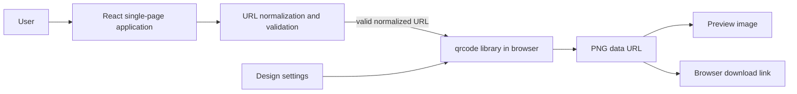

# QR Studio — System Architecture Report

## A. Executive summary

QR Studio is a single-page application that encodes HTTP(S) destinations as locally generated QR codes. It offers URL validation, live preview, palette and color editing, size, quiet-zone and correction controls, and PNG download. It has no accounts, server-side generation, database, URL storage, or external QR service. Browser availability and QR capacity are the main constraints.

## B. Technology stack

| Technology | Responsibility | Choice and trade-off |
|---|---|---|
| React 18 + TypeScript strict | UI and typed state | Familiar component model; adds runtime and build dependencies. |
| Vite 6 | Development and production bundling | Fast static build and SPA preview; no server runtime required. |
| qrcode | Standards-compliant QR encoding and PNG data URL output | Runs locally; a small focused dependency rather than a remote API. |
| Framer Motion | Entrance and preview transitions, button feedback | Used for restrained transitions; reduced motion is respected. |
| Lucide React | Consistent interface icons | Tree-shakeable SVG components. |
| Vitest, Testing Library, jsdom | Utility and component tests | Fast browser-like unit/component coverage; not a substitute for real device scanning. |
| ESLint, TypeScript | Static quality checks | Finds common issues and enforces strict typing. |

CSS uses system font stacks and custom CSS instead of a UI framework or remotely hosted assets. Playwright is not configured in this initial implementation.

## C. System architecture



The React app calls the validation utility before committing a URL. The QR utility wraps `qrcode.toDataURL` with the current design. That PNG data URL is both the preview source and download payload, keeping the export synchronized. No backend, database, or QR API is needed because encoding and file creation use browser-side JavaScript and DOM download behavior.

## D. Component architecture

`src/App.tsx` contains the page sections and workflow. The header/hero, customization panel, preview, steps, and footer are composed within that component rather than split into individual files. This keeps the small interface direct, though further growth would justify extracting view components.

App state includes raw input, committed normalized URL, design settings, generated PNG, generation revision, error/status messages, download feedback, URL display toggle, and copy feedback. Form submission validates and commits; controls update settings, which regenerates the current QR; reset restores defaults. `src/lib/url-validation.ts` and `src/lib/qr-generator.ts` keep validation and encoding/download utilities outside presentation code.

## E. Data flow

```mermaid
sequenceDiagram
  actor User
  participant UI as React UI
  participant V as URL utility
  participant Q as qrcode
  participant B as Browser
  User->>UI: Enter link and submit
  UI->>V: Trim, normalize, validate
  alt invalid input
    V-->>UI: Inline validation error; clear stale preview
  else valid HTTP(S) URL
    V-->>UI: Normalized URL
    UI->>Q: URL + current color, size, margin, correction
    Q-->>UI: PNG data URL
    UI-->>User: Live preview and ready status
    User->>UI: Download PNG
    UI->>B: Click temporary anchor with sanitized filename
  end
```

Whitespace is trimmed. A domain lacking a scheme receives `https://`. The URL API parses it; only HTTP(S) and a dotted hostname are accepted, with a 2,048-character input limit. Invalid input clears the currently displayed image rather than presenting a QR for a different input. Encoder errors clear the image and offer recovery guidance.

## F. State management

QR generation starts after valid explicit submission and whenever settings change while a committed URL exists. A generation revision also supports submitting the same link again. Each asynchronous effect uses an `active` cleanup flag so superseded results cannot replace a newer preview. Invalid input clears the committed URL and QR image. Reset only restores design settings; editing the URL does not imply the currently displayed QR encodes the edited draft, and the preview is cleared when Generate is pressed with invalid input.

## G. QR encoding and export

The `qrcode` package creates a PNG data URL at the chosen 256, 512, 1,024, or 2,048 pixel width and selected L/M/Q/H error correction. Quiet-zone margins default to four modules and can be increased. The chosen background color is supplied as the opaque light color and foreground as the dark color. Contrast is computed from relative luminance; combinations below 4.5:1 show a warning. The browser downloads the already-sized PNG directly, so no small bitmap is upscaled. The filename contains a sanitized hostname.

Color, print quality, reflective surfaces, damage, scanner quality, and dense/long destinations affect scanability. The app encourages testing before distribution. High correction levels reduce capacity for a given QR version; encoder errors suggest shorter links or a lower correction level.

## H. Shneiderman's eight golden rules

| Rule | Implemented feature | Verification |
|---|---|---|
| Consistency | Shared palette, buttons, spacing, control styles | Inspect controls across desktop and mobile. |
| Universal usability | Responsive layout, keyboard-operable native controls, inline errors | Tab through the page and use narrow viewport. |
| Informative feedback | Validation, ready pill, live status, download feedback | Submit invalid/valid links and download. |
| Closure | Ready preview and download completion message | Complete the create-preview-download flow. |
| Error prevention | Scheme/length checks, safe defaults, contrast warning, invalid actions disabled | Try unsupported links and weak colors. |
| Reversal | Reset and editable settings | Change a palette then reset. |
| User control | Explicit Generate and Download actions; no URL navigation | Enter a URL and verify no network/navigation occurs. |
| Reduce memory load | Persistent labels, selected values, URL summary and visible settings | Inspect workspace without remembering prior choices. |

## I. Security and privacy threat model

| Asset / threat | Mitigation | Residual risk |
|---|---|---|
| User-entered destination | Strict HTTP(S) parsing, length cap; never fetched, executed, or opened | A syntactically valid link may still be malicious when scanned. |
| QR image output | Generated locally from bundled `qrcode`; no remote QR provider | Package defects or browser implementation bugs remain possible. |
| Browser storage/network | No persistence, analytics, API, or application network calls | Static hosting still serves application assets; browser extensions may observe activity. |
| Dependency supply chain | Lockfile, minimal runtime dependencies, maintenance checklist | Dependencies can contain vulnerabilities; review advisories and updates. |
| Static hosting policy | Vercel headers set CSP, nosniff, referrer, and permissions policy | CSP should be rechecked against the actual deployment and any future assets. |

Production CSP permits same-origin scripts/connectivity, same-origin and data/blob images, inline styles needed by bundled UI styling, and same-origin/data fonts; it denies objects and framing and restricts forms/base URLs. It does not use `unsafe-eval`. No secrets or user URL are sent to a server. This static design removes server-side input handling and storage, reducing the exposed attack surface but not eliminating malicious destination risk.

## J. Reliability and failure handling

Empty, malformed, unsupported-scheme, too-long inputs produce recoverable inline errors. QR encoding exceptions clear the preview and advise shortening the link or changing correction. Superseded generation results are ignored. Download uses a browser anchor and reports success; exceptions produce an error. No object URL is created, so no object-URL cleanup is needed. The supported browsers are modern browsers with ES modules, URL, Blob/data URL, and anchor download support. Clipboard copy requires Clipboard API availability and is guarded.

## K. Testing strategy and results

Vitest covers URL normalization, rejected inputs and maximum length, QR options and encoder failures, contrast and filename sanitation, and component validation, preview clearing, palette/reset interactions, and download initiation. On 2026-10-29, `npm run typecheck`, `npm run lint`, `npm test` (10 tests across 3 files), `npm run build`, `npm audit`, and `npm audit --omit=dev` all passed; both audits reported zero vulnerabilities. Automated Playwright end-to-end tests and physical scan tests are not included. The Vercel headers are configured but have not been verified on a deployed site. Manual scan tests across phones and print sizes remain a useful release check.

## L. Performance and accessibility

The application is a static client bundle. QR generation is local and starts only after explicit submit or a setting update. A stale-result guard avoids race conditions. Layout stacks on mobile, with URL input/preview/download prioritized. Semantic forms and labels, visible focus, native controls, text status/error announcements, alt text, and reduced-motion CSS/Motion behavior support accessibility. Contrast warning is presented in text and not by color alone. A full WCAG audit has not been performed.

## M. Build and deployment

Install with `npm install`, develop with `npm run dev`, and create production assets using `npm run build` (TypeScript build plus Vite). Vercel serves `dist`; `vercel.json` defines security headers and an SPA rewrite. GitHub deployment is connected through Vercel's repository import. No environment variables are required. The local production build passed; after deployment, verify the CSP response in browser developer tools.

## N. Project structure

```text
.
├── docs/SYSTEM_ARCHITECTURE_REPORT.md  # this report
├── src/
│   ├── lib/url-validation.ts           # normalization and validation
│   ├── lib/qr-generator.ts             # QR, contrast, and filename helpers
│   ├── test/setup.ts                   # test matchers
│   ├── App.tsx                         # single-page UI and state flow
│   ├── App.test.tsx                    # component workflow tests
│   ├── index.css                       # responsive styling and motion settings
│   └── main.tsx                        # React entry point
├── index.html                          # document metadata and root
├── package.json / package-lock.json    # scripts and pinned dependency graph
├── tsconfig*.json                      # strict TypeScript config
├── vite.config.ts                      # Vite and Vitest config
├── eslint.config.js                    # lint rules
└── vercel.json                         # static hosting headers and fallback
```

## O. Limitations and future improvements

Future possibilities include dynamic redirect QR codes, cloud synchronization, accounts, and logo overlays; these are intentionally not implemented. Playwright coverage, cross-browser downloads, physical scan testing, additional color-vision and contrast review, and extraction of UI sections into components can be added later. No claim is made that a QR destination is safe.

## P. Maintenance checklist

1. Review dependency release notes and security advisories before updating.
2. Update dependencies deliberately and commit the resulting lockfile.
3. Run `npm run typecheck`, `npm run lint`, `npm test`, and `npm run build`.
4. Test valid, malformed, long, Unicode, query-string, and fragment URLs.
5. Scan exported PNGs with multiple devices and review at intended print size.
6. Check keyboard navigation, reduced motion, and narrow/mobile layouts.
7. Inspect CSP and security headers on the Vercel deployment after changing assets or dependencies.
